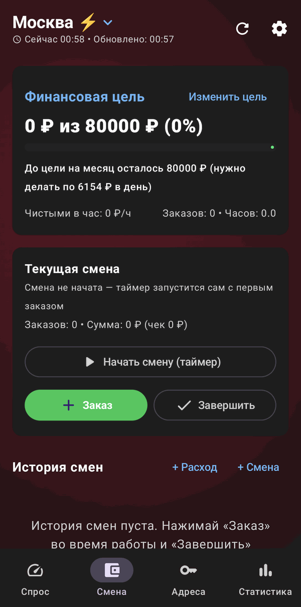
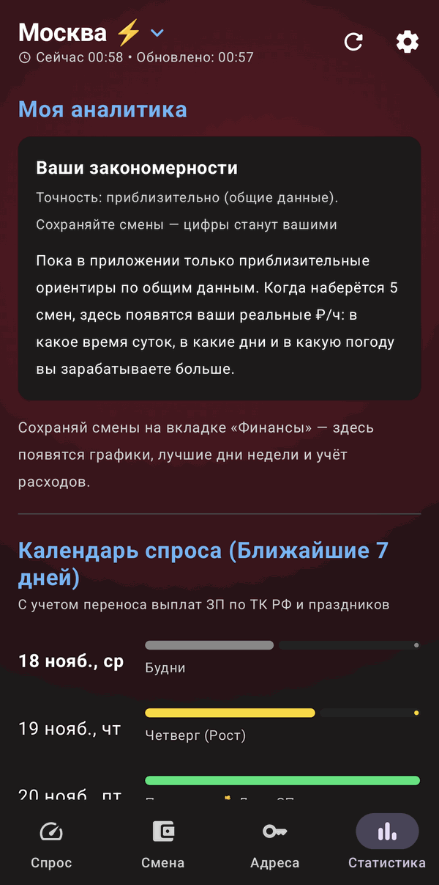

# Курьер Живи

[](https://github.com/DomenicoCano/KurerZhivi/releases/latest/download/KurerZhivi.apk)

Android-приложение для курьеров доставки (пеших, вело, электровело и авто). Оценивает текущий спрос по 100-балльной шкале с учётом погоды, перепадов атмосферного давления, времени суток, дня недели, переноса зарплатных дней по ТК РФ, праздников и свежих городских новостей, ведёт таймер активной смены с паузами в шторке уведомлений и на виджете рабочего стола, считает чистый доход за вычетом расходов и налога самозанятого, хранит базу домофонов и работает даже при мобильном интернете по «белым спискам». Написано на Kotlin и Jetpack Compose (Material 3, Room, WorkManager).

<p align="center">
  
</p>

| Смена и финансы | Статистика и календарь |
|---|---|
|  |  |

## Установка

1. Скачайте [`KurerZhivi.apk`](https://github.com/DomenicoCano/KurerZhivi/releases/latest/download/KurerZhivi.apk) со страницы [Releases](../../releases).
2. Откройте файл на смартфоне и разрешите установку из неизвестных источников, если Android попросит.
3. Выберите свой город и профиль транспорта, при первом запуске смены разрешите уведомления — тогда текущая смена закрепится в шторке с кнопками быстрого добавления заказов.

**Удаление:** стандартное удаление приложения средствами Android. Требуется Android 7.0 или новее (API 24+).

## Что умеет приложение

- **Балл спроса 0–100:** почасовой таймлайн на 12 часов, прогноз на 3 дня, таймер рассвета/заката, анализ перепадов атмосферного давления, подсказки горячих зон и суточный ритм спроса.
- **Персональный ориентир ₽/ч:** на основе сохранённых смен приложение рассчитывает ожидаемый чистый доход в час для текущего времени суток, дня недели и погоды, а также сравнивает доходность агрегаторов.
- **Профили транспорта (Пеший, Вело, Электро, Авто):** калькулятор просадки ёмкости Li-ion АКБ на холоде и ветре, оценка расхода калорий, подсказки по экипировке и технике.
- **Смена «на линии»:** таймер с учётом перерывов (пауза/продолжить), закреплённое уведомление в шторке с вводом суммы и чаевых (`+ N ₽`, `320+50`, `+100`) без выхода из навигатора и виджет для рабочего стола.
- **Финансы и отчётность:** цель на месяц, раздельный учёт топлива/зарядки, ремонта и прочих/внесменовых расходов, налог самозанятого (`0% / 4% / 6%`), выбор даты смены, экспорт в CSV (UTF-8 с BOM и `;` для Excel), ручной JSON-бэкап и еженедельный автобэкап в выбранную папку (SAF).
- **База домофонов и проблемных точек:** копирование кода в одно касание, закрепление частых адресов, фильтры по категориям, открытие адреса в картах и нечёткий поиск (игнорирует `ё/е`, пунктуацию и сокращения вроде `ул.`, `д.`, `корп.` — запрос `ленина 15 2` находит `ул. Ленина, д. 15, корп. 2`).
- **Режим «Белые списки»:** встроенный офлайн-справочник городов России, погода через Яндекс Погоду / Рамблер.Погоду и городские новости из российских RSS-лент (РИА, ТАСС, Лента, РБК, РГ, Коммерсантъ, Рамблер, МК, АиФ, Интерфакс).

## Что проверено

- Подписанная release-сборка `1.4` (`versionCode 7`, включены R8-минификация и сжатие ресурсов) установлена поверх предыдущей версии и запущена на смартфоне Xiaomi `2511FPC34G` (Android 16) — без падений в `logcat`; на экране устройства проверены все 4 нижние вкладки.
- На ПК пройдены 68 юнит-тестов (`LogicTest.kt`): расчёт баллов, просадка АКБ, перенос зарплатных дней и праздников, аналитика смен и пауз, нечёткий поиск адресов, фильтрация городов в RSS, разбор HTML/JSON Яндекс Погоды и Рамблер.Погоды, а также совместимость бэкапов v1–v4.
- Подпись релизного `KurerZhivi.apk` проверена `apksigner` (APK Signature Scheme v2); исходный код и собранный APK проверены сканером приватности на отсутствие локальных путей и учётных данных сборщика.

## Известные ограничения

- На устройстве проверялась работа интерфейса и запуск release-сборки на одном смартфоне (Android 16); другие модели устройств и более ранние версии Android 7–15 не тестировались.
- В режиме «белых списков» без собственного ключа API погода извлекается со страницы Яндекс Погоды (с откатом на Рамблер.Погоду для базовых городов и локальный кэш); при изменении вёрстки сайта или появлении капчи парсер страницы вернёт пустой ответ.
- APK подписан собственным ключом разработчика, а не через Google Play — при установке Google Play Защита может вывести предупреждение о неизвестном авторе.
- О найденных проблемах сообщайте в [Issues](../../issues).

## Сборка из исходников

Нужны JDK 17+ и Android SDK (`compileSdk = 37`).

```bash
./gradlew assembleDebug
./gradlew assembleRelease
```

Особенности на Windows при кириллице в пути проекта или профиля пользователя:

- В `gradle.properties` включён `android.overridePathCheck=true`, поэтому сборка APK работает из любой папки.
- Для запуска юнит-тестов (`:app:testDebugUnitTest`) проект нужно скопировать в папку с ASCII-путём (подробнее в [CLAUDE.md](CLAUDE.md)).
- Вариант `debug` использует `applicationIdSuffix = ".debug"` и устанавливается рядом под именем «Курьер Живи (Тест)», не затрагивая базу релизной версии.
- Для подписанной release-сборки ключ подписи и пароли хранятся локально вне git.

## Контрольная сумма

SHA-256 файла `KurerZhivi.apk` (релиз `v1.4.0`):

```text
7998d921e283b4364b5f77f3fba7b447915af30d40aa9f20ec9c918a61439da7
```

## Состав репозитория

| Путь | Назначение |
|---|---|
| `app/src/main/java/com/example/myapplication/model/` | Модели данных и Room-сущности (`ShiftEntry`, `IntercomNote`) |
| `app/src/main/java/com/example/myapplication/logic/` | Чистая бизнес-логика: балл спроса, календарь, аналитика, ритм, персональная калибровка |
| `app/src/main/java/com/example/myapplication/data/` | Сеть (Open-Meteo, Яндекс/Рамблер, RSS), Room БД, настройки, справочник городов, бэкапы |
| `app/src/main/java/com/example/myapplication/ui/` | Экраны на Jetpack Compose, `CourierViewModel` и виджет `CourierWidget` |
| `app/src/main/java/com/example/myapplication/work/` | Фоновые воркеры уведомлений, еженедельный автобэкап (SAF) и панель смены в шторке |
| `app/src/main/assets/ru_cities.tsv` | Офлайн-справочник городов России |
| `app/src/test/java/com/example/myapplication/LogicTest.kt` | Юнит-тесты бизнес-логики, парсеров и бэкапов |
| `docs/` | Скриншоты для README |

Собранный APK в дерево репозитория не коммитится — он прикреплён только в [Releases](../../releases).

## Важно

Неофициальное приложение для личного учёта курьера, не связанное с Яндекс Едой, Деливери, Самокатом, Купером и другими сервисами доставки. Балл спроса и ориентир заработка являются расчётной оценкой и не гарантируют доход.

Используемые источники данных:

- Справочник городов России: [hflabs/city](https://github.com/hflabs/city), лицензия [CC BY-SA 4.0](https://creativecommons.org/licenses/by-sa/4.0/).
- Погода и геокодинг: [Open-Meteo](https://open-meteo.com/), Яндекс Погода, Рамблер.Погода.
- Суточные интервалы спроса: открытое исследование сервиса «Чиббис» (2025).
